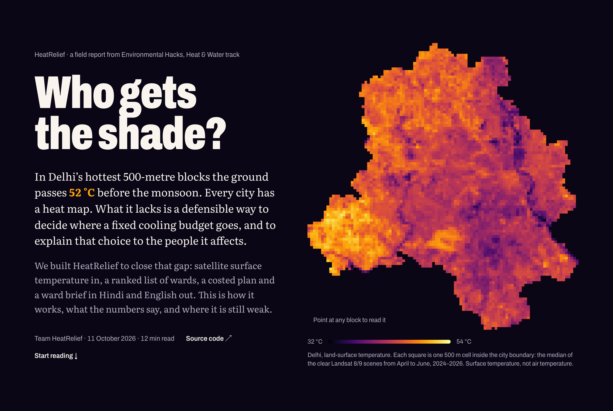
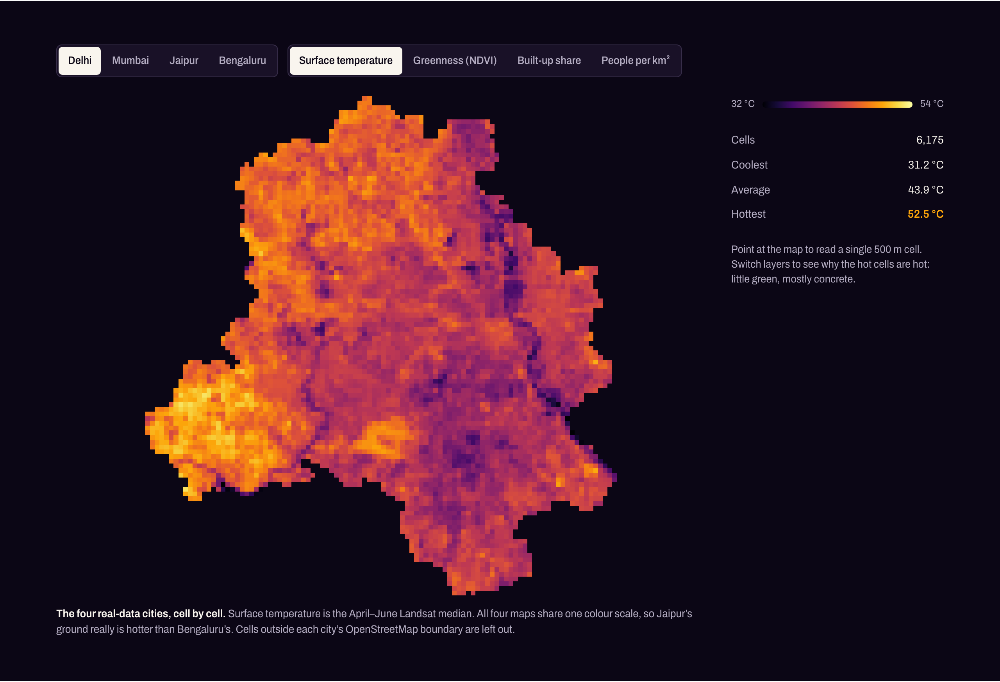
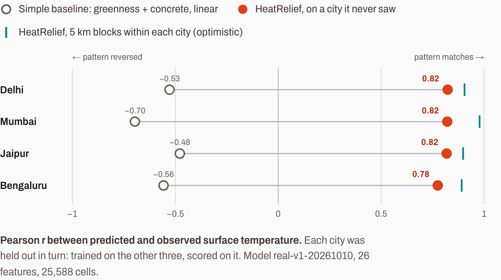
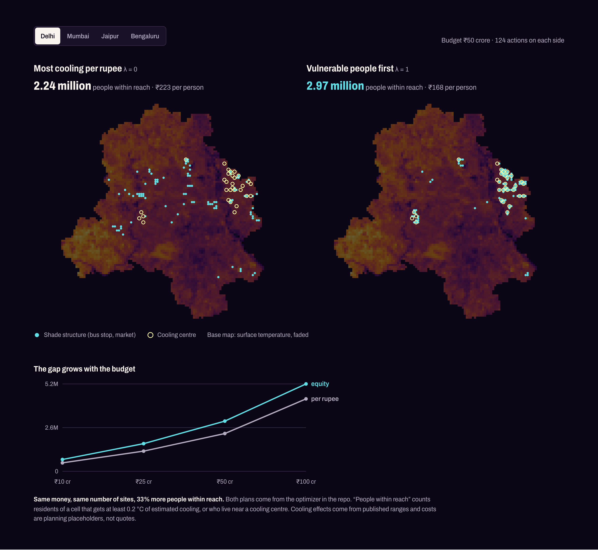
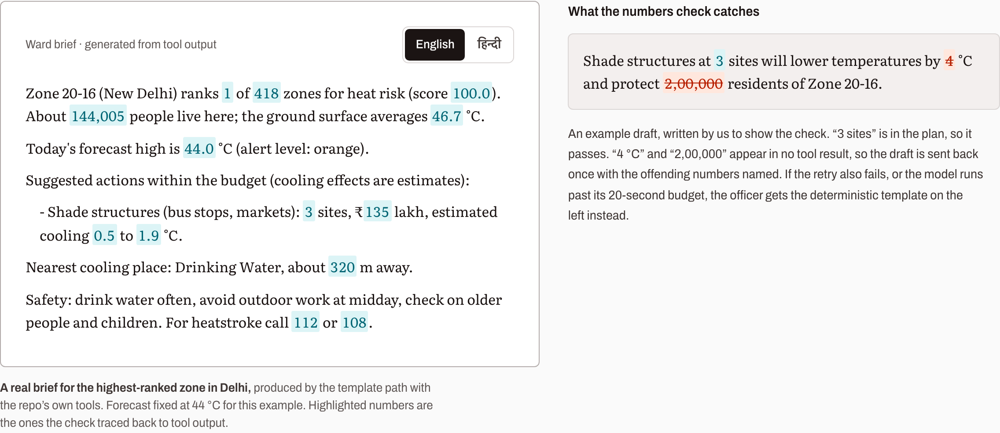
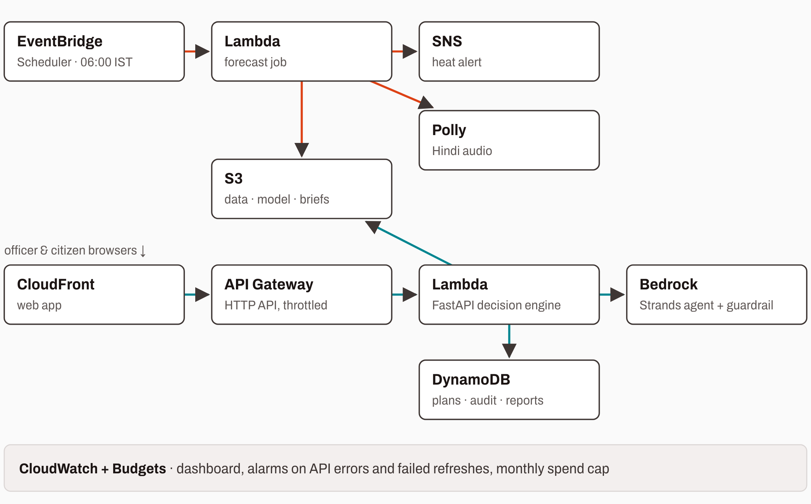

# Who gets the shade? Turning satellite heat maps into cooling decisions for Indian cities on AWS

*Team HeatRelief · Environmental Hacks (WeMakeDevs × AWS), Heat & Water track*

In Delhi's hottest 500-metre blocks the ground passes **52 °C** before the monsoon. Every city has a heat map like the one above. What it lacks is a defensible way to decide where a fixed cooling budget goes, and to explain that choice to the people it affects.

We built **HeatRelief** to close that gap. Satellite surface temperature goes in. Out come a ranked list of wards, a costed cooling plan and a ward brief in Hindi and English. This post covers the problem, the stack, where AWS fits and what fought back.

**Interactive version:** [http://heatrelief-blog-blogbucket-vxqiftyjihko.s3-website-us-east-1.amazonaws.com/](http://heatrelief-blog-blogbucket-vxqiftyjihko.s3-website-us-east-1.amazonaws.com/) · **Code:** https://github.com/abhaysingh81/Urban_Heat_Mitigation_AWS · **Demo video:** [YouTube link]

## The problem: a heat map is not a decision

The WHO estimates about **489,000 heat-related deaths a year** worldwide (2000–2019), 45% of them in Asia. The 2024 Lancet Countdown found heat deaths among people over 65 were **167% higher in 2023** than in the 1990s. In 2023 the Centre for Policy Research reviewed **37 Indian heat action plans across 18 states**. It found weak local data, little targeting of vulnerable people, unclear funding and almost no transparency about why money went where it did.

A satellite map answers "where is the ground hot?". A municipal officer needs to know who lives there, what each rupee buys, how sure we are, and how to explain the choice. HeatRelief is decision support for that. It will not stop a heatwave, and it does not pretend to.

## What we built

One loop, six steps, each with an output an official can inspect and overrule:

1. **Observe:** Landsat surface temperature and land-cover features on a 500 m grid.
2. **Rank:** hazard × exposure × vulnerability per zone, with every component visible.
3. **Compare:** five cooling actions, each with a published low/mid/high effect range.
4. **Allocate:** a fixed budget, with a dial between cooling per rupee and equity.
5. **Explain:** a ward brief in Hindi and English whose numbers are machine-checked.
6. **Alert:** a 06:00 forecast job that re-ranks wards and sends the day's alert.

**Before vs. during the event.** We started from an earlier project of ours: a heat-map dashboard with a SHAP view and a two-option scenario builder for 20 cities, running on *synthetic* temperatures. During the hackathon we replaced that core with real satellite data for four cities (Delhi, Mumbai, Jaipur, Bengaluru) and trained and validated a new model. We also built everything after the map: the risk ranking, the optimizer, the AI brief, the morning alert and the AWS stack. The other 16 cities stay in the app as labelled synthetic previews, and no number in this post comes from them.

## The data

Seven open sources go onto a common 500 m grid: Landsat 8/9 Collection 2 surface temperature (the target), Sentinel-2 indices (NDVI, NDBI, MNDWI), ESA WorldCover land cover, the Copernicus DEM, **Meta's HRSL population, read straight from the AWS Open Data Registry on S3**, OpenStreetMap, and Open-Meteo weather.

The target for each city is the median of at least six cloud-free Landsat scenes from April to June, 2024–2026. One hot afternoon can be a fluke; a three-season median shows the blocks that are hot every year.

One caveat sits beside every figure: **surface temperature is not heat stress.** Landsat measures roofs and roads, not the air people breathe.

## The model, tested honestly

We use XGBoost with 26 features, plus two quantile models for a q10–q90 uncertainty band. Neighbouring map cells look alike, so a random split flatters a spatial model. Even holding out 5 km blocks inside each city gave r = 0.89–0.98. That would look great in a pitch, but the model had still seen the city it was tested on.

The honest test is to **train on three cities and score on the fourth**:

| Held-out city | r | RMSE | Bias |
|---|---|---|---|
| Delhi | 0.823 | 2.5 °C | −1.9 °C |
| Mumbai | 0.821 | 3.9 °C | +1.3 °C |
| Jaipur | 0.818 | 3.1 °C | −2.7 °C |
| Bengaluru | 0.775 | 3.9 °C | +3.7 °C |

The spatial pattern transfers well. A straight line through greenness and concrete is *negative* on every unseen city (−0.70 to −0.48). The absolute level does not transfer: each city carries an offset. So we designed around that weakness. Heat tiers and risk use the **observed** Landsat composite wherever it exists. The model only fills gaps and estimates the *difference* an intervention makes, where a city-wide offset cancels out.

## From hot pixels to a ranked list

A hot cell with nobody in it is not an emergency. Each zone gets three percentiles against the rest of its city: **hazard** (mean and 90th-percentile surface temperature), **exposure** (people) and **vulnerability** (density, green deficit, building density). Its score is their product, and every component ships with the score, so "why is my ward third?" has an answer.

## Same ₹50 crore, two plans

The optimizer chooses among trees, cool roofs, shade structures, cool pavements and cooling centres. Each action has a published cooling range, scaled by cell suitability, tree survival and years to maturity. One dial, **λ**, sets the goal: at λ = 0 it buys the most cooling per rupee; at λ = 1 it weights each degree by the vulnerable people who feel it.

In Delhi, the same ₹50 crore and the same 124 sites reach **2.97 million people** under the equity plan against **2.24 million** under the per-rupee plan, which is **33% more**. Cost per person falls from ₹223 to ₹168. The money doesn't change; where it goes does.

The optimizer also showed us a weakness. With our planning-grade cost placeholders, it only ever buys shade structures and cooling centres, never trees. That says nothing about trees. It tells us the inputs need local quotes before anyone uses this for real.

## Briefs with numbers the AI can't invent

The **AI Heat Officer** is a **Strands Agents** agent (AWS's open-source agent SDK) on **Amazon Bedrock**, with **Bedrock Guardrails**. It has five tools: ward risk, ward plan, nearby cooling spots, forecast and heat-health guidance. Code computes every number; the model only phrases it.

After the model writes, a checker extracts every number, in Latin or Devanagari digits, and confirms each one appears in the tool output. On failure the agent retries once with the offending numbers named. If the retry also fails, or the model runs past its 20-second budget, the officer gets a deterministic template instead.

## Where AWS fits

The product has two rhythms, both serverless and both defined in one AWS SAM template:

- **06:00 alert:** EventBridge Scheduler (06:00 IST) runs a Lambda forecast job. It re-ranks wards against today's forecast and writes the result to S3. If the level crosses the threshold, SNS sends the alert and Polly reads the advisory aloud in Hindi (neural voice Kajal).
- **Officer request:** CloudFront serves the web app from a private S3 bucket. API Gateway (HTTP API, throttled) routes requests to a FastAPI Lambda that holds the decision engine. The brief comes from Bedrock through the Strands agent, and plans go to DynamoDB with an audit trail (draft → approved → implemented).
- **Guardrails on the bill:** a CloudWatch dashboard and alarms (API errors, failed refreshes), plus an AWS Budgets monthly cap.

Why these choices: Lambda **container images** because XGBoost, pandas and the geo libraries don't fit in a zip. DynamoDB because plan status changes are appended to an audit log and a plan cannot skip from draft to implemented. Polly because spoken Hindi reaches people an email won't. Budgets because a student project should not be able to run up a bill.

**Status, honestly:** the SAM template validates with cfn-lint and deploys with `scripts/deploy.sh`. At the time of writing, the live Bedrock call has only been exercised through mocked tests. When Bedrock is unreachable, the template brief keeps the product working.

## What fought back

1. **Our original data was wrong.** The pre-hackathon synthetic temperature correlated at r = −0.47 with real Delhi Landsat: hot where the city is cool. We rebuilt everything on observed data.
2. **Random validation lied.** Block CV said 0.89–0.98. Leave-one-city-out said 0.775–0.823 with offsets of up to 3.7 °C, and the architecture changed because of it.
3. **Data sources had opinions.** WorldPop wouldn't serve the range requests our pipeline needs, so we moved to HRSL on the AWS Open Data Registry. The OSM Overpass API throttled us, so cooling-spot coverage is partial in some tiles. Every pipeline stage is cached per city so a failed run resumes instead of restarting.
4. **A valid formula can mislead.** OSM building footprints are off by default, so the building-density part of vulnerability falls back to population density, which then counts twice.
5. **Placeholder costs decide the plan.** See the "never buys a tree" result above.
6. **LLMs are good at words and bad at numbers.** The number check, one retry, a time budget and a template fallback make a wrong figure a contained, visible failure instead of a silent one.
7. **Operator noise shares a pipe with public alerts.** CloudWatch alarms publish to the same SNS topic as heat alerts. Splitting them is our next infrastructure change.

## What it cannot tell you

- Surface temperature is not air temperature or heat stress.
- Risk is a relative ranking within a city, not a prediction of harm.
- Zones are 2 km analysis blocks, not official wards, and there are no age-structure data yet.
- Cooling effects are estimates within published ranges, and costs are placeholders.
- Uncertainty-band coverage is optimistic, because it was calibrated on the same folds it is scored on.
- Only four cities use real data.

**Next:** local cost quotes and peer-reviewed cooling ranges, official ward boundaries, age data, a check of our top zones against a published heat action plan, and separate SNS topics for operators and citizens.

## AI tools we used

- **Claude Code** (Anthropic) helped write the data pipeline, model training, API, infrastructure template and the interactive blog.
- **Google AI Studio** (Gemini) produced the first draft of the blog, which we rewrote.

## Credits

Landsat data courtesy of the U.S. Geological Survey. Contains modified Copernicus Sentinel data. © ESA WorldCover project. Copernicus WorldDEM-30 © DLR e.V. 2010–2014 and © Airbus Defence and Space GmbH 2014–2018, provided under COPERNICUS by the European Union and ESA. Population: Meta Data for Good and CIESIN, Columbia University. © OpenStreetMap contributors. Weather data by Open-Meteo.com.

References: WHO, *Heat and health* fact sheet · Romanello et al., *2024 Lancet Countdown* · Pillai & Dalal, *How is India adapting to heatwaves?*, CPR 2023 · USGS, *Landsat Collection 2 Surface Temperature* · US EPA, *Heat Island Compendium* · Strands Agents SDK.
