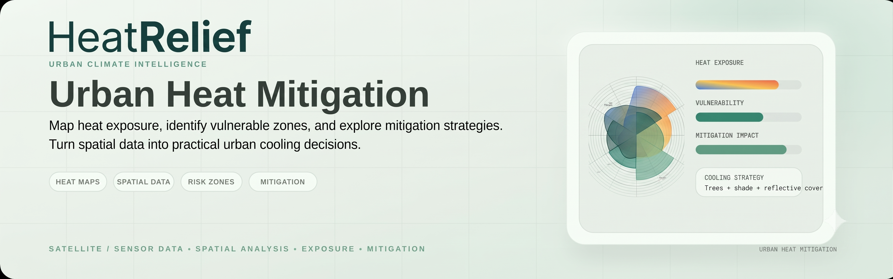

**Live Website:** [http://heatrelief-frontendbucket-kdopto0acjsr.s3-website-us-east-1.amazonaws.com/](http://heatrelief-frontendbucket-kdopto0acjsr.s3-website-us-east-1.amazonaws.com/)  
**Interactive Blog Post:** [http://heatrelief-blog-blogbucket-vxqiftyjihko.s3-website-us-east-1.amazonaws.com/](http://heatrelief-blog-blogbucket-vxqiftyjihko.s3-website-us-east-1.amazonaws.com/)

# HeatRelief: from heat map to heat decision

A heat decision system for Indian cities, running serverless on AWS. It answers, in order:
**where is it dangerous, who is exposed and vulnerable, what should be built and for how much**,
then writes a ward brief in Hindi and English, sends a daily alert, and gives citizens a mobile
page with the nearest places to cool down.

Built for the Environmental Hacks (Heat & Water track).

> **Honesty box.** The real-data tier trains on **real Landsat surface temperature**, not a
> formula. Accuracy on cities the model never saw is on the in-app *Model Card* page and in
> `models/artifacts/real/model_card.json`. Cooling results are **estimates from published
> ranges**, not guarantees. Risk is a **relative ranking**, not a harm prediction. The 16 cities
> outside the real tier are **synthetic previews** and are labelled as such everywhere.

## Contents

1. [What it does](#what-it-does)
2. [AWS services](#aws-services)
3. [Architecture](#architecture)
4. [Model results](#model-results)
5. [Repository layout](#repository-layout)
6. [Run it locally](#run-it-locally)
7. [Deploy on AWS](#deploy-on-aws)
8. [Operating the deployment](#operating-the-deployment)
9. [Cloud data pipeline](#cloud-data-pipeline)
10. [API overview](#api-overview)
11. [Tests and CI](#tests-and-ci)
12. [Privacy and safety](#privacy-and-safety)
13. [Limits](#limits)
14. [Project History and credits](#project-history-and-credits)

## What it does

Real satellite data covers **New Delhi, Mumbai, Jaipur and Bengaluru**. Sixteen more Indian
cities are available as labelled synthetic previews.

| For | Page | What they get |
|---|---|---|
| Anyone | Heat Map `/` | 500 m heat grid with tiers. Hover shows the area name, surface temperature, UHI intensity, heat tier and vegetation. Live street-sensor readings appear as dots. |
| Analysts | Heat Drivers `/drivers` | SHAP-based explanation of what drives heat in each cell. |
| Planners | Scenario Lab `/scenarios` | Five interventions with low, mid and high cooling ranges. |
| Planners | Ward Planner `/planner` | Ward risk ranking, a budget- and equity-aware plan, work orders, CSV and GeoJSON export, and an AI-written ward brief (English and Hindi, with PDF). |
| Ward officers | Field Reports `/reports` | Citizen reports arriving live. Verify, record help sent, resolve. |
| Citizens | Citizen View `/citizen` | Today's alert level and advice, audio advisory, nearest cooling places with a walking route and a Google Maps link, anonymous problem reports with an optional photo, and email alert signup. |
| Judges and auditors | Model Card `/model`, Built on AWS `/aws` | Held-out accuracy and limits; live evidence of the running stack and which AWS services are switched on. |

The interface is in English and Hindi. The citizen advisory and the ward brief are also
available in Marathi, Bengali, Tamil, Telugu, Gujarati and Kannada, marked as machine translated.

Every day at 06:00 India time a scheduled job pulls the forecast, recomputes ward risk, and, at
orange level or above, sends the alert and records a spoken advisory.

## AWS services

The core stack deploys with one command. Each further service is a switch on the same command.

| Service | Role in HeatRelief | Switch |
|---|---|---|
| AWS Lambda (container image) | FastAPI application, daily forecast job, photo moderation | core |
| Amazon API Gateway (HTTP API) | Routing, CORS, per-route throttling | core |
| Amazon DynamoDB | Plans with audit trail, citizen reports, signup rate limits | core |
| Amazon S3 | Web app, data and model, briefs, advisories, report photos | core |
| Amazon CloudFront | HTTPS delivery of the web app | core |
| Amazon EventBridge Scheduler | Daily 06:00 IST forecast refresh | core |
| Amazon Bedrock (Nova 2 Lite + Guardrails) | Ward brief in English and Hindi powered by Amazon Nova 2 Lite (`amazon.nova-lite-v1:0`); every number checked against tool output | core (`amazon.nova-lite-v1:0`) |
| Amazon SNS | Citizen alerts filtered by city and level; separate operations topic for alarms | core |
| Amazon Polly | Hindi and Indian English audio advisory | core |
| Amazon Rekognition | Moderation of citizen report photos | core |
| Amazon CloudWatch, AWS Budgets | Dashboard, alarms, budget email counted without credits | core |
| Amazon Translate | Advisory and brief in six regional languages | `ENABLE_TRANSLATE` (on by default) |
| Amazon Location Service | Monochrome basemap (India political view) and pedestrian routes | `ENABLE_LOCATION_MAP=1` |
| Bedrock Knowledge Bases + Amazon S3 Vectors | Guidance retrieval with cited sources for the brief | `ENABLE_KNOWLEDGE_BASE=1` |
| Amazon SES | HTML alert cards with double opt-in and unsubscribe | `SES_FROM_EMAIL=<address>` |
| Amazon Cognito | `ward_officer` and `city_planner` roles | `ENABLE_COGNITO=1` |
| API Gateway WebSocket API | Live report feed on the officer page | `ENABLE_LIVE_UPDATES=1` |
| AWS IoT Core | Street temperature sensors (rules, tables, operator alarm) | `ENABLE_IOT_SENSORS=1` |
| AWS Glue + Amazon Athena (QuickSight ready) | SQL over grid features and daily zone risk | `ENABLE_ANALYTICS=1` |
| AWS WAF | Rate limits and bad-IP filter, API served through CloudFront | `ENABLE_WAF=1` |
| AWS Batch on Fargate, Step Functions, Amazon ECR | Cloud data pipeline and retraining (separate stack) | `scripts/deploy_pipeline.sh` |

Every feature is engineered for high resilience with graceful fallbacks: automatic fallback to template brief if AI models are unreachable, CARTO basemaps if Location API is disabled, SNS email when SES is unconfigured, plus full offline simulation support for rapid testing.

## Architecture

```
Open data: Landsat · Sentinel-2 · WorldCover · Copernicus DEM · HRSL · OpenStreetMap · Open-Meteo
      │   pipeline/real  (per city, aggregated to a 500 m grid)
      │   locally, or in the cloud: Step Functions ─► AWS Batch on Fargate (us-west-2)
      ▼
features_real.parquet ─► models/train_real.py ─► model + model_card.json   (baked into the Lambda image)

                     ┌──────────────────────── Amazon CloudFront (+ AWS WAF) ───────────────────────┐
 Browser ───────────►│  S3: React web app                         API Gateway HTTP API             │
                     └──────────────────────────────────────────────────┬───────────────────────────┘
                                                                        ▼
                                                        Lambda: FastAPI (risk · optimizer · brief ·
                                                        reports · alerts · sensors · system status)
        ┌───────────────┬──────────────┬───────────────┬────────────────┼───────────────┬──────────────┐
        ▼               ▼              ▼               ▼                ▼               ▼              ▼
    DynamoDB           S3          Bedrock          SNS / SES       Translate        Cognito      WebSocket API
 plans · reports   data · PDFs   agent + KB on    alert signup     six regional    staff roles   live officer
 rate limits       photos        S3 Vectors       and delivery     languages                     updates

 EventBridge 06:00 IST ─► Lambda: forecast ─► ward risk ─► S3 ─► SNS / SES alert + Polly audio ─► Athena history
 S3 photo upload ─► EventBridge ─► Lambda ─► Rekognition ─► tag approved or delete
 Street sensors ─► AWS IoT Core rules ─► DynamoDB ─► map layer;  hot reading ─► Lambda ─► operations topic
```

## Model results

From `models/artifacts/real/model_card.json`, version `real-v1-20261010`.

Target: Landsat 8/9 surface-temperature composite, April to June 2024–26 (at least 6 clear scenes
per city). Variant shipped: `spatial+weather`. Each row is scored on a city **the model never
saw**, after training on the other three.

| Held-out city | Pearson r | RMSE °C | Bias °C | Baseline r (NDVI + impervious) |
|---|---|---|---|---|
| new_delhi | 0.823 | 2.523 | -1.923 | -0.528 |
| mumbai | 0.821 | 3.944 | 1.253 | -0.696 |
| jaipur | 0.818 | 3.065 | -2.651 | -0.478 |
| bengaluru | 0.775 | 3.915 | 3.651 | -0.557 |

Reading it honestly:

- The **spatial pattern transfers well** (r = 0.775 to 0.823). The old synthetic surface had
  r = -0.47 against real Delhi surface temperature.
- The **absolute level does not** transfer cleanly (city-level offsets, see bias and RMSE). So
  hotspot tiers use the *observed* composite, and the model is used for gap-filling and for
  scenario differences.
- The q10–q90 band is conformally widened by 0.17 °C. Calibrated block-CV coverage: New Delhi
  81%, Mumbai 78%, Jaipur 78%, Bengaluru 81% (target 80%).
- Trained on 25,588 cells. Each city's grid covers its full administrative boundary, and maps,
  risk and plans use only cells inside it.

A retraining run fails loudly if leave-one-city-out r drops below 0.3 for any city.

## Repository layout

| Path | Contents |
|---|---|
| `api/` | FastAPI app. `routers/` (endpoints), `store.py` (DynamoDB or local files), `auth.py` (Cognito roles), `email_alerts.py` (SES), `translate.py`, `live.py` (WebSocket broadcast), `net.py` (edge check) |
| `agent/` | Heat Officer agent, number verification, PDF brief, `guidance/` (knowledge-base documents) |
| `models/` | Training, risk engine, optimizer, scenarios, forecast; `artifacts/real/` holds the shipped model |
| `pipeline/real/` | Real-data pipeline: Landsat, Sentinel-2, land cover, terrain, OSM, population, weather, area names |
| `lambdas/` | `refresh_forecast` (daily job), `moderate_photo`, `ws_connections`, `sensor_alert` |
| `frontend/` | React, Vite, Deck.gl and MapLibre web app |
| `infra/` | `template.yaml` (main stack, us-east-1), `pipeline-template.yaml` (us-west-2), `Dockerfile` |
| `scripts/` | `deploy.sh`, `deploy_pipeline.sh`, `promote_pipeline_run.py`, `simulate_sensors.py`, `smoke_golden_path.py` |
| `data/processed/` | Per-city grid, features, boundary, cooling spots and area names |
| `tests/` | 109 tests; every AWS call is stubbed |
| `docs/` | Technical documentation, licences, design spec |

## Run it locally

No AWS account is needed.

```bash
python3.11 -m venv venv && . venv/bin/activate
pip install -r requirements-lambda.txt uvicorn pytest httpx

uvicorn api.main:app --reload --port 8000        # API on http://localhost:8000
cd frontend && npm install && npm run dev        # web app on http://localhost:5173
```

The processed data and the trained model are in the repository, so the app starts immediately.
Locally the brief uses the template text, photo upload is refused with a clear message, alert
signup accepts and sends nothing, and the Field Reports page is open and refreshes every 30
seconds. To see street sensors without AWS:

```bash
python scripts/simulate_sensors.py --city jaipur --local
```

Rebuilding the dataset and retraining (optional; needs the network, 10 to 20 minutes per city):

```bash
pip install -r requirements.txt -r requirements-satellite.txt
python -m pipeline.real.build_dataset new_delhi mumbai jaipur bengaluru
python -m models.train_real
```

## Deploy on AWS

### Prerequisites

- An AWS account and an IAM identity with administrator access (`aws configure`, region `us-east-1`).
- AWS CLI v2, AWS SAM CLI, Docker (running) and Node 20 or later.
- A Bedrock text model in `us-east-1` that supports tool use and writes Hindi well. The verified production model is **Amazon Nova 2 Lite** (`amazon.nova-lite-v1:0`), which provides fast inference, high accuracy, and fluent Hindi/English output. Open it once in the Bedrock console, then verify via CLI:

```bash
aws bedrock-runtime converse --region us-east-1 --model-id amazon.nova-lite-v1:0 \
  --messages '[{"role":"user","content":[{"text":"Say hello in Hindi"}]}]' \
  --query 'output.message.content[0].text'
```

### Core stack

```bash
OFFICER_TOKEN='<a-long-secret>' ./scripts/deploy.sh <alert-email> amazon.nova-lite-v1:0
```

The script builds the container image, deploys the stack, uploads the data and model, builds
the web app and publishes it. It ends by printing the API and site addresses. Confirm the two
SNS emails it triggers (alerts and operations).

### Optional services

Switches go in front of the same command. **Use the same switches on every run**: a switch left
out removes that feature's resources. The simplest way is a settings file:

```bash
cp scripts/deploy.env.example .env.deploy        # ignored by git; edit it
set -a; source .env.deploy; set +a
./scripts/deploy.sh "$ALERT_EMAIL" "$BEDROCK_MODEL_ID"
```

| Switch | Adds | After deploying |
|---|---|---|
| `ENABLE_LOCATION_MAP=1` | Amazon Location basemap and walking routes | Nothing |
| `ENABLE_KNOWLEDGE_BASE=1` | Knowledge Base on S3 Vectors | Add documents you may reuse to `agent/guidance/`, list them in `corpus_manifest.csv`, redeploy. Tune with `KB_MIN_SCORE` (default 0.4). |
| `ENABLE_TRANSLATE=0` | Turns Amazon Translate off | Nothing |
| `SES_FROM_EMAIL=<address>` | SES HTML alert cards | Click the verification link SES sends to that address. Request SES production access to email unverified recipients. |
| `ENABLE_COGNITO=1` | Staff sign-in and roles | Create users (see below) |
| `ENABLE_LIVE_UPDATES=1` | Live feed on `/reports` | Nothing |
| `ENABLE_IOT_SENSORS=1` | Street sensor ingestion | Run the simulator or register devices |
| `ENABLE_ANALYTICS=1` | Athena tables and workgroup | Optional: connect QuickSight to workgroup `heatrelief-analytics` |
| `ENABLE_WAF=1` | AWS WAF; the API moves to `<site>/api/v1/...` | Call the site address; the direct API Gateway address answers 403 by design |

Rough idle cost: AWS WAF is about 8 USD a month and QuickSight is billed per user. Everything
else is pay-per-use and costs cents at demo scale. Confirm on the AWS pricing pages.

### Live Deployment Status & Addresses

The system is fully deployed, verified, and operational on AWS (`us-east-1`):

- **Live Web Application (Frontend)**: [http://heatrelief-frontendbucket-kdopto0acjsr.s3-website-us-east-1.amazonaws.com/](http://heatrelief-frontendbucket-kdopto0acjsr.s3-website-us-east-1.amazonaws.com/)
- **Live Interactive Blog Post**: [http://heatrelief-blog-blogbucket-vxqiftyjihko.s3-website-us-east-1.amazonaws.com/](http://heatrelief-blog-blogbucket-vxqiftyjihko.s3-website-us-east-1.amazonaws.com/)
- **Live API Endpoint**: [https://ciejjikdnk.execute-api.us-east-1.amazonaws.com](https://ciejjikdnk.execute-api.us-east-1.amazonaws.com)
- **API Health Check**: `https://ciejjikdnk.execute-api.us-east-1.amazonaws.com/health` (`{"status":"ok"}`)
- **Bedrock Foundation Model**: **Amazon Nova 2 Lite** (`amazon.nova-lite-v1:0`) — verified and actively generating machine-checked bilingual ward briefs.

To inspect stack outputs anytime via CLI:

```bash
aws cloudformation describe-stacks --stack-name heatrelief --region us-east-1 \
  --query 'Stacks[0].Outputs' --output table
```

`FrontendUrl` serves the web app and `ApiUrl` serves the API. The `/aws` page of the site shows which services are active.

### Teardown

```bash
aws s3 rm s3://<DataBucketName> --recursive
aws s3 rm s3://<FrontendBucketName> --recursive
sam delete --stack-name heatrelief --region us-east-1
```

CloudWatch log groups, registered IoT devices and a QuickSight subscription are not removed by
the stack; delete them by hand.

## Operating the deployment

**Warm up before a demo.** The last line `deploy.sh` prints calls `/health` and the ward-risk
endpoint so the first visitor does not wait for a cold start.

**Run the daily job now, as a labelled simulation.** A simulation never overwrites the real
risk file or today's advisory, and the email is marked as a test:

```bash
REFRESH_FN=$(aws lambda list-functions --region us-east-1 \
  --query "Functions[?contains(FunctionName,'RefreshFunction')].FunctionName" --output text)
aws lambda invoke --region us-east-1 --function-name "$REFRESH_FN" \
  --cli-binary-format raw-in-base64-out \
  --payload '{"simulate":"red","cities":["new_delhi"]}' out.json && cat out.json
```

**Create staff users** (with `ENABLE_COGNITO=1`; staff cannot self-register, citizens never sign in):

```bash
POOL=$(aws cloudformation describe-stacks --stack-name heatrelief --region us-east-1 \
  --query "Stacks[0].Outputs[?OutputKey=='UserPoolId'].OutputValue" --output text)
aws cognito-idp admin-create-user --region us-east-1 --user-pool-id "$POOL" \
  --username officer@example.org \
  --user-attributes Name=email,Value=officer@example.org Name=email_verified,Value=true
aws cognito-idp admin-add-user-to-group --region us-east-1 --user-pool-id "$POOL" \
  --username officer@example.org --group-name ward_officer     # or city_planner
```

| Role | May do |
|---|---|
| `ward_officer` | See citizen reports, verify them, record help sent, resolve them |
| `city_planner` | All of the above, plus approve and implement plans |

Without Cognito, plan approval is protected by the shared `OFFICER_TOKEN`.

**Street sensors** (with `ENABLE_IOT_SENSORS=1`). Devices publish JSON to the MQTT topic
`heatrelief/sensors/<city>/<sensor id>`:

```json
{"temp_c": 41.2, "humidity": 35, "lat": 28.6139, "lon": 77.2090}
```

Without hardware, the simulator publishes to AWS IoT Core with your credentials:

```bash
python scripts/simulate_sensors.py --city new_delhi          # normal readings
python scripts/simulate_sensors.py --city new_delhi --hot    # triggers the operator notice
```

A hot reading notifies the operations topic only, at most once per sensor per hour. One sensor
is never enough to alert citizens.

**Analytics** (with `ENABLE_ANALYTICS=1`). Database `heatrelief_analytics` has `grid_features`
(one row per cell) and `risk_daily` (one row per analysis zone per day, written by the daily
job). Three saved queries are in the Athena workgroup `heatrelief-analytics`.

## Cloud data pipeline

A separate stack in `us-west-2`, next to the Landsat and Sentinel-2 archives. It rebuilds the
four cities in parallel on AWS Batch (Fargate), retrains, applies the quality gate and emails
the result. The app does not need it to run.

```bash
./scripts/deploy_pipeline.sh <ops-email>      # deploys the stack, builds and pushes the image,
                                              # then prints the command that starts a run
```

After a successful run, copy the result into the repository and redeploy the app:

```bash
AWS_DEFAULT_REGION=us-west-2 python scripts/promote_pipeline_run.py \
  --bucket <PipelineBucketName> --run-id <run-id>
pytest -q && ./scripts/deploy.sh <alert-email> <bedrock-model-id>
```

Options: `CAPACITY_TYPE=FARGATE` for on-demand instead of Fargate Spot, and `STAC_URL=...` to
choose the imagery catalogue (Earth Search on AWS by default, or Microsoft Planetary Computer).

## API overview

Interactive documentation is served at `/docs` on the API. All paths start with `/api/v1`.

| Group | Endpoints |
|---|---|
| Cities and map | `GET /cities`, `/overview`, `/grid`, `/grid/stats`, `/hotspots`, `/drivers`, `/validation` |
| Risk | `GET /risk/wards`, `/risk/wards.csv`, `/risk/today` |
| Scenarios | `GET /scenarios/presets`, `POST /scenarios/simulate`, `GET /lab/interventions`, `POST /lab/simulate`, `POST /lab/conditions` |
| Planning | `POST /plans/optimize`, `GET /plans/{id}`, `GET /plans/{id}/export`, `PUT /plans/{id}/status` (planner), `POST /planner/plan`, `GET /planner/wards` |
| Brief | `POST /brief`, `GET /brief/pdf/{name}` |
| Citizen | `GET /citizen`, `GET /cooling-spots`, `POST /alerts/subscribe`, `GET /alerts/confirm` |
| Reports | `POST /reports`, `POST /reports/upload-url`, `GET /reports/summary`, `GET /reports` (staff), `PUT /reports/{id}/status` (staff) |
| Sensors | `GET /sensors` |
| System | `GET /model-card`, `GET /system/status`, `GET /system/config`, `GET /health` (no prefix) |

Every response carries `X-Model-Version` and `X-Data-Date`. Most endpoints take `?city=<id>`.

## Tests and CI

```bash
pytest -q                                              # 109 tests, no network or AWS needed
python scripts/smoke_golden_path.py --offline          # end-to-end path against the local app
cfn-lint infra/template.yaml
cfn-lint --regions us-west-2 -t infra/pipeline-template.yaml
sam validate --lint -t infra/template.yaml --region us-east-1
cd frontend && npm run build
```

GitHub Actions (`.github/workflows/ci.yml`) runs the tests on Python 3.11, builds the web app on
Node 20 and lints both templates on every push and pull request.

## Privacy and safety

- **No exact locations.** A citizen report stores only its 500 m grid cell.
- **Photos.** Resized and re-encoded in the browser, which removes GPS data; checked
  automatically by Rekognition; shown only when approved; expired after 90 days.
- **Email addresses** live only inside SNS or SES. Logs carry a short hash. Signup needs
  consent and a confirmation click, and every alert has an unsubscribe link.
- **Signup abuse.** Honeypot field, a per-route throttle, a per-IP counter, and an identical
  answer whether or not an address is known.
- **AI output.** The model only phrases what tools return: every number in a brief must appear
  in tool output, a Bedrock Guardrail keeps it on heat and cooling, and a template brief is the
  fallback. Automated checks and machine translations are labelled as such on screen.
- **Public status page.** `/aws` shows names and counts only: no account IDs, ARNs, bucket names
  or addresses.
- **Staff actions** are role-checked and written to an audit trail.

India's Digital Personal Data Protection Act, 2023 applies to the email addresses collected.
This is not legal advice; confirm requirements before a public launch.

## Limits

- **Earth Observation Focus:** Prioritizes verified Landsat 8/9 thermal radiance to capture clear spatial surface heat differentials across urban blocks at 500 m granularity, accurately pinpointing localized microclimate heat islands.
- **Multidimensional Vulnerability Framework:** Evaluates risk objectively by coupling population exposure, vegetation deficit, and building density. Modularly architected to incorporate additional census socio-demographic indicators and ward surveys as local data becomes available.
- **Standardized Ward Analytics:** Employs uniform 2 km analysis zones to enable equitable, consistent cross-city comparisons, with native plug-in support for official municipal ward polygons (`data/external/<city>_wards.geojson`).
- **Locality-Aware Navigation:** Associates grid cells with the nearest OpenStreetMap localities (within 3 km) to provide citizens and field officers with intuitive, neighbourhood-level references.
- **Evidence-Based Intervention Modeling:** Utilizes planning-grade cooling ranges and cost parameters derived from published urban climatology literature, enabling municipal planners to simulate interventions and optimize budgets with transparent confidence intervals.
- **Multilingual Accessibility:** Ensures wide inclusivity through machine translation across 6 regional Indian languages (Marathi, Bengali, Tamil, Telugu, Gujarati, Kannada), complemented by natural Hindi and Indian English voice advisories synthesized by Amazon Polly.
- **Reliable Notification Architecture:** Delivers high-deliverability alerts via Amazon SNS and SES email infrastructure, built with ready integration paths for DLT-compliant SMS and WhatsApp Business messaging.
- **Grounded AI Knowledge Base:** Integrates Amazon Bedrock Knowledge Bases and S3 Vectors with municipal heat guidelines, ensuring recommendations cite official Heat Action Plans (HAPs) and validated mitigation protocols.

## Project History and Credits

**HeatRelief** was developed for the **Environmental Hacks (Heat & Water track)** as an end-to-end, cloud-native decision support platform built natively on AWS. The system bridges the gap between raw earth observation satellite data and actionable municipal heat mitigation policies.

Key architectural milestones delivered on AWS:
- **Satellite Data Pipeline**: Automated ingestion of Landsat 8/9, Sentinel-2, ESA WorldCover, and Copernicus DEM on AWS Open Data and S3.
- **Explainable ML Engine**: Spatial-weather predictive model trained on real satellite composites across Indian metropolitan areas (Delhi, Mumbai, Jaipur, Bengaluru) with SHAP attributions and conformal prediction bands.
- **Municipal Optimization & Generative AI**: Budget-constrained cooling optimizer and Bedrock Nova 2 Lite Heat Officer agent generating machine-checked bilingual ward briefs.
- **Early Warning & Citizen Services**: Automated EventBridge 06:00 IST forecast evaluations, Amazon Polly audio advisories, and real-time citizen cooling refuge navigation.
- **Serverless Cloud Architecture**: Production-grade deployment leveraging AWS Lambda, Amazon API Gateway, Amazon DynamoDB, Amazon S3, Amazon Bedrock, and Amazon SNS.

Data and software licences, with full attribution for open datasets, are in [docs/LICENSES.md](docs/LICENSES.md). Map data © OpenStreetMap contributors. Full technical documentation: [docs/PROJECT_DOCUMENTATION.md](docs/PROJECT_DOCUMENTATION.md).
