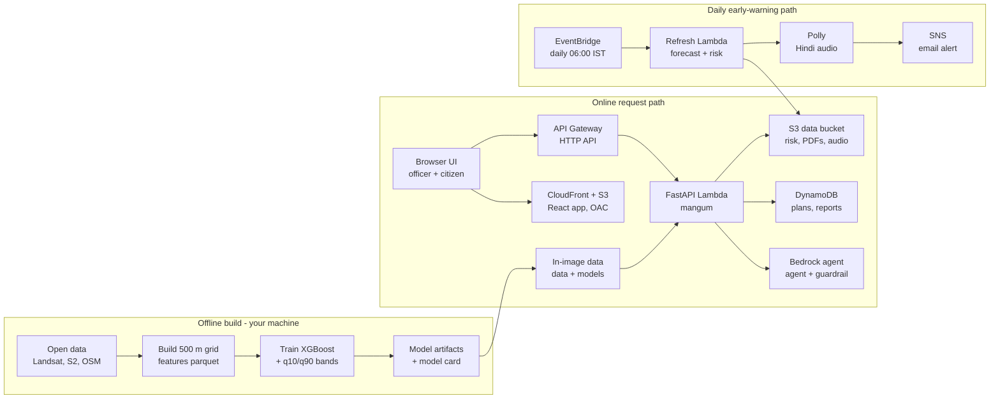

# HeatRelief — Project Documentation

As of 2026-10-10. Also available as an editable doc: https://claude.ai/code/artifact/be6ff508-f930-4781-bcc8-7936d37df045

## 1. Overview

HeatRelief is a heat decision system for Indian cities: it takes a city from "where is it dangerous" to "what should we build, for how much" and delivers a written ward brief in Hindi and English, a daily alert and a citizen page. It was built for the Environmental Hacks hackathon (Heat & Water track) on AWS.

**The decision chain it supports**

1. Where is it dangerous? Real Landsat surface temperature, mapped on a 500 m grid.
2. Who is exposed and vulnerable? Ward risk = hazard × exposure × vulnerability.
3. What should be built? A budget- and equity-aware optimizer picks interventions (trees, cool roofs and others).
4. How is it communicated? An AI agent writes a ward brief in English and Hindi, exported as a PDF.
5. Who is warned today? A scheduled job computes risk each morning and sends an email alert plus a Hindi voice message.

**Scope**

| Tier | Cities | Data |
| --- | --- | --- |
| Real-data tier | New Delhi, Mumbai, Jaipur, Bengaluru | Real Landsat LST, Sentinel-2, WorldCover, Copernicus DEM, Meta HRSL population, OSM, weather |
| Synthetic previews | 16 other cities | Synthetic generator, labelled as preview everywhere in the UI |

**Honesty statement (carried into the app)**

- The model trains on real Landsat surface temperature, not a formula. Accuracy on cities it never saw is shown on the in-app Model Card page.
- Cooling results are estimates from published ranges, not guarantees.
- Risk is a relative ranking across wards, not a prediction of harm.
- Land surface temperature is not air temperature and not heat stress.

**What existed before vs. what was built for the event**

The base project was a React and Deck.gl heat-map dashboard with SHAP driver analysis and a two-intervention scenario builder for 20 cities, on a synthetic data generator and a FastAPI service (Vercel and Render). Everything else in this document was built for the event: the real-data pipeline, model, risk engine, optimizer, agent, early warning, plan lifecycle, Model Card, citizen view, bilingual UI and the AWS deployment.

## 2. System architecture



Officers and citizens reach one FastAPI Lambda through CloudFront and API Gateway. The same image carries the processed data and model, while DynamoDB, S3 and Bedrock hold plans, files and the agent. A 06:00 IST EventBridge schedule runs a second Lambda that writes today's risk to S3, then creates Polly audio and an SNS email. Section 9 details each service.

**Design principles**

- **Real data first.** The model trains on real Landsat temperature, and the app labels every synthetic city as a preview.
- **Numbers must be traceable.** The brief's figures are verified against tool output, and each response carries the model version and data date.
- **Degrade, never fail.** The forecast, Bedrock, Polly and PDF each have a fallback, so the core ranking and plan always work.
- **Runs without AWS.** Storage falls back to local files and briefs to a template, so development and tests need no account.
- **Serverless and cheap when idle.** Lambda, DynamoDB on demand and S3 lifecycle rules, with a budget alarm.

## 3. Real-data pipeline

The pipeline (`pipeline/real/`) turns open satellite and ancillary data into one table per city, `features_real.parquet`, on a 500 m grid. Run with `python -m pipeline.real.build_dataset <city>`. Each stage caches its result under `data/raw/real/<city>/`, so a re-run after a network failure resumes instead of restarting.

**Grid.** `gridspec.py` builds a UTM fishnet of 500 m cells per city. Every source raster is warped onto a finer integer subdivision of that grid and block-averaged to the cell. Landsat is handled at 50 m (factor 10) because its native resolution is 30 m.

**Stages and sources**

| Stage | Module | Source | Licence | Produces |
| --- | --- | --- | --- | --- |
| landsat | `landsat_composite.py` | Landsat 8/9 Collection 2 Level-2 (USGS) | Public domain | Target `lst_c`, the surface temperature |
| sentinel2 | `sentinel2.py` | Copernicus Sentinel-2 L2A | Copernicus (free, open) | NDVI, NDBI, MNDWI |
| landcover | `landcover.py` | ESA WorldCover 2021 | CC BY 4.0 | Fractions: impervious, tree, vegetation, bare soil, water |
| terrain | `terrain.py` | Copernicus DEM GLO-30 | Copernicus (free use) | Elevation, slope |
| osm | `osm_features.py` | OpenStreetMap | ODbL | Cooling spots; building density and height only when footprints are enabled (off by default, set `HEATRELIEF_OSM_BUILDINGS=1`) |
| population | `population.py` | Meta HRSL | CC BY 4.0 | Population density |
| weather | `weather.py` | Open-Meteo archive (ERA5-based) | CC BY 4.0 | Scene-date air temperature, humidity, wind, solar radiation, heat index, wet-bulb |

Imagery is read through a STAC catalogue (`stac.py`), so nothing is downloaded in bulk.

**The target: a multi-scene Landsat composite**

- Hot-season windows April to June of 2024, 2025 and 2026.
- Scenes with cloud cover under 20% only, at least 6 clear scenes per city, at most 14.
- Cloud, cirrus and shadow are masked with the `QA_PIXEL` band. `ST_B10` is calibrated to °C with the official USGS scale and offset.
- The per-pixel median across scenes is taken, so the target is not one lucky or unlucky pass.

**Derived features**

- `context_features.py` adds neighbourhood context: 3-cell and 7-cell window means of NDVI, impervious fraction, building density and population density (the `_ctx3` and `_ctx7` columns).
- `green_deficit` and `veg_imperv_ratio` are derived from land cover.
- Heat index and wet-bulb temperature come from the weather stage.

**Analysis zones ("wards").** `wards.py` assigns each cell to a zone. By default these are 2 km × 2 km blocks (4 × 4 cells) named Zone r-c. If official ward polygons are placed at `data/external/<city>_wards.geojson` (with a `name` property), cells are assigned by centroid instead. The result is reported as `2km_analysis_zones` or `official_boundaries`.

**Outputs per city** (in `data/processed/<city>/`): `features_real.parquet`, `cooling_spots.json` and `data_card.json` (sources, licences, scene counts). The four cities together give 19,681 usable cells for training.

## 4. Machine-learning model

The model predicts Landsat surface temperature per 500 m cell from land cover, vegetation, built form, terrain, population and weather. It transfers its spatial pattern well to cities it has never seen (Pearson r 0.72 to 0.89), but its absolute level does not, so the app shows the observed composite for hotspot tiers and uses the model to fill gaps and to compute scenario deltas.

**Training (`models/train_real.py`)**

- Target: `lst_c`, the Landsat 8/9 C2 L2 `ST_B10` median composite (°C), April to June 2024 to 2026.
- Estimators: an XGBoost point model plus two XGBoost quantile models (q10 and q90) for an uncertainty band.
- Two feature sets are trained and compared: `spatial` (20 land-cover, vegetation, built-form, terrain, population and context features) and `spatial+weather` (adds air temperature, humidity, wind, solar radiation, heat index and wet-bulb). The one with the lower leave-one-city-out RMSE ships; the shipped variant is `spatial+weather` with 26 features.
- Cells outside the best Landsat tile footprint have no target and are excluded. The shipped model version is `real-v1-20261010`, trained on 19,681 cells.
- Run: `python -m models.train_real`. Add `--allow-weak` to ship even if the quality gate fails.

**Evaluation, written to `models/artifacts/real/model_card.json`**

- Leave-one-city-out: train on three cities, score the fourth. This is the honest test of transfer.
- Spatial block CV with 5 km blocks (10 cells), because neighbouring cells are strongly correlated and a random split would leak.
- Baselines: global mean, and a linear model on NDVI plus impervious fraction.
- Quality gate: the build fails if Pearson r on any held-out city is below 0.3.

**Result on a city the model never saw**

| Held-out city | Pearson r | RMSE (°C) | Bias (°C) | Baseline r (NDVI + impervious) |
| --- | --- | --- | --- | --- |
| New Delhi | 0.790 | 2.397 | -1.917 | -0.306 |
| Mumbai | 0.885 | 3.513 | 0.123 | -0.687 |
| Jaipur | 0.721 | 3.613 | -3.165 | -0.273 |
| Bengaluru | 0.804 | 3.909 | 3.697 | -0.486 |

Read honestly: the spatial pattern transfers; the absolute level carries a city-level offset (the bias column). The old synthetic surface had r = -0.47 against real Delhi LST, which is what motivated the real-data tier.

**Within-city accuracy (5 km spatial block CV).** Pearson r is 0.88 to 0.98 and RMSE about 0.9 to 1.2 °C across the four cities.

**Uncertainty.** The q10 to q90 band is conformally widened by 0.25 °C. Calibrated block-CV coverage against an 80% target is New Delhi 82%, Mumbai 73%, Jaipur 74% and Bengaluru 81%. The model card notes that this coverage is measured on the same folds used to widen it, so it is optimistic.

**Explainability (`models/explain_real.py`).** SHAP values are stored in `shap_values.parquet`. The top drivers by mean absolute SHAP are water fraction (1.23), NDBI built-up index (1.20), maximum air temperature (0.82), MNDWI (0.57) and elevation (0.46). The Drivers page in the UI shows these. SHAP explains the model, not causal effects.

**Artifacts** (`models/artifacts/real/`): `lst_point.json`, `lst_q10.json`, `lst_q90.json`, `feature_names.json`, `feature_importance.json`, `shap_values.parquet`, `model_card.json`.

**Known limitations (from the model card)**

- Surface temperature is not air temperature or heat stress.
- With only four training cities the model cannot learn a reliable weather-to-level relationship; weather features are city-level constants.
- Cooling scenario results are clamped to published ranges, not measured.

## 5. Risk engine, optimizer and scenarios

Three modules turn the temperature map into a decision: `models/risk.py` ranks wards, `models/optimizer.py` chooses where to spend a budget, and `models/real_simulate.py` tests what-if scenarios. All three use the same per-cell table, with observed Landsat temperature where it exists and the model prediction where it does not.

### 5.1 Ward risk

Risk is a relative ranking, not a harm estimate. Each component is a 0 to 1 percentile rank across the city's wards:

```latex
risk = 100 \cdot \frac{hazard \times exposure \times vulnerability}{\max(hazard \times exposure \times vulnerability)}
```

| Component | Definition |
| --- | --- |
| Hazard | 0.6 × percentile of ward mean surface temperature + 0.4 × percentile of ward 90th-percentile surface temperature |
| Exposure | Percentile of ward total population (Meta HRSL) |
| Vulnerability | 0.5 × percentile of population density + 0.3 × percentile of green deficit + 0.2 × percentile of building density (a crowding proxy) |

Zones with fewer than 3 cells are dropped as edge slivers. Every component is returned so a ranking can be explained. Age structure, income and informal-settlement data are not in v1, and the API says so in its `method.not_included` field.

### 5.2 Daily alert level

The forecast (Open-Meteo) sets a city-level alert on two separate scales, and the higher one wins:

| Level | Daily max temperature (°C) | Heat index (°C) |
| --- | --- | --- |
| Yellow | 40 or above | 32 or above |
| Orange | 42 or above | 41 or above |
| Red | 45 or above | 54 or above |

Heat index only escalates the alert on days with a maximum of at least 35 °C, so a humid but mild day raises no alarm. `risk_today` then applies the alert level to the ward ranking (multipliers 1.0 green, 1.2 yellow, 1.5 orange, 2.0 red) and returns the top wards. If the forecast is unavailable, the API falls back to hot-season climatology and flags the result as stale.

### 5.3 Budget and equity optimizer

Given a budget in INR lakh, the optimizer picks at most one intervention per 500 m cell, greedily by benefit per cost, never exceeding the budget:

```latex
benefit = |cooling_{mid}| \times hazard\_weight \times \big((1-\lambda) + \lambda \cdot vulnerable\_people\_weight\big)
```

- λ is the equity weight. At 0 the plan maximises cooling per rupee in the hottest, most suitable cells. At 1 it maximises cooling delivered to vulnerable people. The two usually disagree, and the `compare` option returns both so an officer sees the trade-off.
- Cooling centres are placed first, from a share of the budget (15% by default). Each pick maximises vulnerable people not yet covered within walking distance, counting the cell itself plus a quarter of its four neighbours.
- A cell only counts as protected if its mid cooling reaches 0.2 °C.
- Each cell has a suitability score per intervention (space to plant, roof share, foot traffic). Tree effects are scaled by survival rate (default 0.7) and ramped over the years to full effect, across a 10-year horizon.
- The result carries an impact card, a timeline and per-item cost, people covered and cooling as {low, mid, high}.

### 5.4 Interventions and cost

Cooling ranges are from the published urban-heat literature and are deliberately broad. Costs are planning-grade placeholders, not quotes.

| Intervention | Cooling range (°C) | Years to full effect | Cost per 500 m cell (INR lakh) |
| --- | --- | --- | --- |
| Tree cover | -3.0 to -0.8 | 8 | 120 |
| Cool roofs | -1.5 to -0.4 | 0 | 60 |
| Shade structures (bus stops, markets) | -2.0 to -0.5 | 0 | 45 |
| Cool pavements | -1.2 to -0.3 | 1 | 80 |
| Cooling centre | none (access, not temperature) | 0 | 25 |

### 5.5 Scenario simulator

`real_simulate.simulate` applies intensity-based interventions to target cells (by default the critical and high hotspot tiers). Each cell's cooling is the published range times cell suitability times intensity, times tree survival where it applies. The response keeps the older `/scenarios/simulate` shape and adds low, mid and high estimates. Hotspot tiers are assigned from the temperature distribution: critical above mean + 2 standard deviations, high above mean + 1.

### 5.6 Plan lifecycle

Saved plans move through `draft`, then `approved`, then `implemented`. An approved plan can be sent back to draft, and an implemented plan is final. Every change appends an audit entry (time, actor, note), and plans export as CSV or GeoJSON.

## 6. AI agent: the Heat Officer

The Heat Officer (`agent/heat_officer.py`) writes a short action brief for one ward in English and Hindi. The language model can only phrase the brief; every number in it is checked against what the tools returned, and a deterministic template brief is always available if the model fails.

**Framework.** The Strands Agents SDK on Amazon Bedrock. The model is whatever `BEDROCK_MODEL_ID` names (a model enabled in the account and region), at temperature 0.2. If `BEDROCK_GUARDRAIL_ID` is set, the agent runs behind that Bedrock Guardrail.

**Tools the agent can call**

| Tool | Returns |
| --- | --- |
| `get_ward_risk` | Rank, risk score, hazard, exposure, vulnerability, population, mean and hottest-decile surface temperature |
| `get_ward_plan` | Optimizer result for this ward under the officer's budget: top 3 actions with count, cost (INR lakh) and estimated cooling range |
| `get_cooling_spots` | Three nearest cooling places with type and distance in metres (from OSM) |
| `get_forecast` | Today's maximum temperature, heat index and alert level (Open-Meteo) |
| `search_guidance` | Paraphrased general heat-safety advice from `agent/guidance/heat_guidance.md` (hydration, timing, cooling spaces, vulnerable groups, heatstroke, infrastructure) |

**Prompt rules.** Use only numbers that appear in tool results and never calculate new ones. Describe cooling as estimated, with the low to high range as given. Medical advice is limited to general cooling and safety guidance; otherwise refer to a doctor or 112 / 108. Stay on heat, cooling and this ward. Output only JSON with `en` and `hi`. Each brief covers why the ward ranks where it does, the top 3 actions with cost, where people can cool down today, and a one-line safety note, in under 180 words.

**Number verification (`agent/numbers_check.py`).** Every number in the draft, including Devanagari digits, is extracted and must appear in the tool-result log or the vetted guidance text. The flow:

1. The agent runs and every tool result is appended to a log.
2. The draft is rejected if it called no tools or used a number not in the log.
3. On rejection there is one corrective retry that names the offending numbers.
4. If the retry also fails, or Bedrock is unavailable (access denied, outage, bad JSON), the template brief is used.

The response reports `source` (`bedrock` or `template`), a `note` explaining any fallback, `numbers_verified`, and the `facts` the brief was built from.

**Template fallback.** `template_brief` builds the same brief from the facts with fixed English and Hindi sentences. It is used whenever `BEDROCK_MODEL_ID` is not set, as in a local run. A forecast outage does not block the brief; the forecast section is simply omitted.

**PDF export (`agent/brief_pdf.py`).** A one-page A4 PDF with both languages, built with fpdf2 and HarfBuzz text shaping so Devanagari conjuncts and vowel signs render correctly. Noto Sans and Noto Sans Devanagari are bundled in `agent/fonts/`. On AWS the PDF is written to S3 under `briefs/` and returned as a presigned URL (30-day lifecycle expiry); locally it is saved under the runtime directory and served from `/api/v1/brief/pdf/<name>`. A PDF failure never loses the brief itself.

## 7. Backend API

The backend is a FastAPI app (`api/main.py`) with nine routers under `/api/v1`. The same app runs locally under Uvicorn and on AWS inside Lambda through Mangum (`api/lambda_handler.py`). Every response carries `X-Model-Version` and `X-Data-Date` headers taken from the model card, for traceability. A `city` query parameter selects the city; real-data endpoints return a clear 404 for a synthetic preview city.

**Endpoints**

| Router | Endpoint | Purpose |
| --- | --- | --- |
| overview | `GET /health`, `GET /api/v1/cities`, `GET /api/v1/overview` | Liveness, city list with data kind (real or synthetic preview), KPI summary |
| grid | `GET /api/v1/grid`, `GET /api/v1/grid/stats` | Grid cells and statistics for the map |
| hotspots | `GET /api/v1/hotspots` | Hotspot tiers (critical, high, moderate, normal, cool) |
| drivers | `GET /api/v1/drivers`, `GET /api/v1/drivers/hotspot-drivers` | SHAP-based drivers of heat |
| scenarios | `POST /api/v1/scenarios/simulate`, `GET /api/v1/scenarios/presets` | What-if cooling simulation with low, mid and high estimates |
| risk | `GET /api/v1/risk/wards`, `GET /api/v1/risk/wards.csv`, `GET /api/v1/risk/today` | Ward risk table with method, CSV export, today's forecast-adjusted ranking |
| plans | `POST /api/v1/plans/optimize`, `GET /api/v1/plans/{id}`, `GET /api/v1/plans/{id}/export`, `PUT /api/v1/plans/{id}/status` | Optimizer, saved plan, CSV or GeoJSON export, status change with audit trail |
| brief | `POST /api/v1/brief`, `GET /api/v1/brief/pdf/{name}` | Ward brief (English and Hindi) and its PDF |
| reports | `POST /api/v1/reports`, `POST /api/v1/reports/upload-url`, `GET /api/v1/reports/summary` | Citizen ground-truth reports, presigned photo upload, most-reported cells |
| meta | `GET /api/v1/model-card`, `GET /api/v1/cooling-spots`, `GET /api/v1/citizen` | Model card, nearest cooling places, the citizen "what do I do today" payload |

**Data source layer (`api/data_source.py`).** A single place decides where a city's data comes from. A real-data city is served from `features_real.parquet` and its predictions; every other city is the legacy synthetic preview. Routers call these helpers instead of hard-coding paths.

**Persistence (`api/store.py`).** Plans and citizen reports use DynamoDB when `PLANS_TABLE` and `REPORTS_TABLE` are set, and JSON files under `RUNTIME_DIR` otherwise, so local development and tests need no AWS. Items keep the whole document as a JSON string, which avoids DynamoDB's restrictions on floats. Plan statuses and audit entries are described in section 5.6.

**AWS access layer (`api/aws.py`).** All AWS configuration is read from environment variables, never hard-coded: `DATA_BUCKET`, `PLANS_TABLE`, `REPORTS_TABLE`, `AWS_REGION` (default `us-east-1`) and `RUNTIME_DIR`. boto3 clients are created lazily and cached, so the app imports and runs with no AWS credentials.

**Citizen reports.** Reports (`no_shade`, `no_water`, `very_hot`, `cool_spot`) are snapped to their 500 m grid cell, and exact coordinates are not stored. Notes are capped at 300 characters. An optional photo is uploaded straight from the browser to S3 through a presigned PUT URL valid for 10 minutes. Photo upload only works on the AWS deployment.

**Graceful degradation**

- The forecast fails: `/risk/today` returns the last good result flagged `stale`, then hot-season climatology.
- Bedrock is unavailable or unconfigured: the brief falls back to the template.
- A PDF error is returned as `pdf_error` without losing the brief.
- Polly or SNS problems in the daily job never stop the risk file from being written.

**CORS.** The FastAPI app allows localhost:5173, the original Vercel deployment and any origins in `CORS_ORIGINS`. API Gateway allows any origin because the read API uses no credentials.

## 8. Frontend

The frontend (`frontend/`) is a React 19 single-page app built with Vite. Maps use Deck.gl on MapLibre through react-map-gl, routing uses react-router, and icons come from lucide-react. The API address comes from `VITE_API_BASE_URL` and falls back to `http://localhost:8000`.

**Pages**

| Route | Page | Audience | What it shows |
| --- | --- | --- | --- |
| `/` | Map (`MapView`) | Officer | Heat map of the 500 m grid with hotspot tiers |
| `/drivers` | Drivers | Officer | SHAP drivers of heat |
| `/scenarios` | Scenarios | Officer | What-if cooling simulator with low, mid and high estimates |
| `/risk` | Ward Risk | Officer | Ward ranking by hazard, exposure and vulnerability, with CSV export |
| `/plan` | Action Plan | Officer | Budget and equity optimizer, impact card, plan status, ward brief and PDF |
| `/model` | Model Card | Officer and judges | Held-out accuracy, baselines, limits and data sources |
| `/citizen` | Citizen view | Public | Mobile-first "what do I do today" page without the sidebar |

**Citizen view.** A standalone mobile page that shows today's alert level, plain-language advice in English or Hindi, the nearest cooling places and the Hindi audio advisory when the daily job has produced one. People can submit anonymous reports such as "no shade here". It is an installable progressive web app: `manifest.webmanifest` starts at `/citizen`, and `sw.js` caches the app shell first and tries the network first for citizen API calls, falling back to the last good answer on weak networks.

**Language.** `i18n.js` and `LangProvider.jsx` provide an English and Hindi toggle for the interface. An onboarding component explains the app on first use.

**Trust cues in the UI.** Synthetic-preview cities are labelled as previews. The Model Card page shows the held-out accuracy and limits described in section 4. Estimates are labelled as estimates.

**Theming and layout.** Light and dark themes (`ThemeContext.jsx`), a collapsible sidebar, an About modal, and a notice when the API server is waking up (useful on a cold Lambda start).

## 9. AWS integration

The whole system is serverless on AWS and is defined in one SAM template (`infra/template.yaml`, 318 lines). The default region is us-east-1. Fourteen service types are used across compute, storage, AI, messaging, delivery and operations. Status: the template validates with cfn-lint but the stack has not been deployed yet, and the live Bedrock path has only been tested against a mock (section 11.3).

**Service map**

| AWS service | Resource in the stack | What it does here | Where in code |
| --- | --- | --- | --- |
| Lambda (container image) | `ApiFunction`: 2048 MB, 29 s timeout | Runs the FastAPI app through Mangum | `api/lambda_handler.py`, `infra/Dockerfile` |
| Lambda (container image) | `RefreshFunction`: 1536 MB, 300 s timeout | Daily forecast, risk, alert job | `lambdas/refresh_forecast/app.py` |
| API Gateway (HTTP API) | `HttpApi` | Public entry point, catch-all `/{proxy+}` to Lambda, throttled to 10 requests per second with burst 20, exposes the model-version headers | `infra/template.yaml` |
| EventBridge Scheduler | `Daily` event on `RefreshFunction` | Fires `cron(0 6 * * ? *)` in the Asia/Kolkata time zone | `infra/template.yaml` |
| Amazon S3, data bucket | `DataBucket`: private, AES-256 encrypted | Processed features, model artifacts, `risk_today/<city>.json`, `advisories/<city>/<date>.mp3`, `briefs/*.pdf` (expire after 30 days), `report_photos/*` (expire after 90 days) | `api/aws.py`, `api/routers/brief.py`, `api/routers/reports.py` |
| Amazon S3, frontend bucket | `FrontendBucket`: private | Holds the built React app | `scripts/deploy.sh` |
| CloudFront | `FrontendDistribution` plus Origin Access Control | HTTPS delivery of the frontend; 403 and 404 return `index.html` for single-page routing; bucket is reachable only through CloudFront (SigV4) | `infra/template.yaml` |
| DynamoDB | `PlansTable`, `ReportsTable`: on-demand billing, server-side encryption | Plan lifecycle with audit trail; citizen reports | `api/store.py` |
| Amazon Bedrock | Model named by `BedrockModelId` | The Heat Officer agent writes the bilingual brief (through Strands) | `agent/heat_officer.py` |
| Bedrock Guardrails | `HeatGuardrail` plus `HeatGuardrailVersion` | Keeps the agent on heat topics | `infra/template.yaml` |
| Amazon SNS | `AlertTopic` plus email subscription | Heat alerts, CloudWatch alarm notifications | `lambdas/refresh_forecast/app.py` |
| Amazon Polly | Neural voice Kajal, hi-IN | Hindi audio advisory saved as MP3 in S3 | `lambdas/refresh_forecast/app.py` |
| CloudWatch | Dashboard, 2 alarms, custom metrics | Operational visibility | `infra/template.yaml` |
| AWS Budgets | `MonthlyBudget`: 25 USD default, alert at 80% | Cost guard | `infra/template.yaml` |
| IAM | SAM policy templates and statements | Least-privilege roles per function | `infra/template.yaml` |

### 9.1 Request path (officer and citizen)

The browser loads the React app from CloudFront (S3 origin). API calls go to API Gateway, which proxies every path to the API Lambda. FastAPI reads the baked-in processed data and model artifacts, reads and writes DynamoDB for plans and reports, calls Bedrock for briefs, and reads and writes S3 for PDFs and advisories. The Lambda image bundles `api`, `agent`, `lambdas`, `models` and `data`, with only the pipeline pieces it needs (`pipeline/config.py`, `gridspec.py` and `weather.py`), so training-only packages such as shap, geopandas and rasterio stay out of the image.

### 9.2 Early-warning path (daily at 06:00 IST)

1. EventBridge Scheduler invokes `RefreshFunction`.
2. For each real-data city it pulls a 3-day forecast from Open-Meteo and computes the heat index.
3. It recomputes today's ward risk and writes `risk_today/<city>.json` to S3. The API serves the last good file, flagged stale, if a later refresh fails.
4. If the alert level is at or above `AlertMinLevel` (orange by default), it asks Polly for a Hindi advisory (voice Kajal, neural engine, `hi-IN`) and stores the MP3 under `advisories/<city>/<date>.mp3`.
5. It publishes an email through SNS with the top 5 risk zones, the advice text and a presigned link to the audio, valid for 7 days.
6. It emits CloudWatch metrics `AlertsFired`, `RefreshOk` and `RefreshFailed` per city.

Each city is isolated: a failure in one is logged, counted and does not stop the others. Polly failure never blocks the alert. SMS to India needs DLT registration, so alerts go by email.

### 9.3 Bedrock agent path

The Strands agent calls Bedrock with the model in `BEDROCK_MODEL_ID` and, when set, the guardrail ID and version. The guardrail denies two topics, medical diagnosis or treatment and off-topic requests (politics, finance, general chat), applies high-strength hate, violence, sexual and prompt-attack filters, and returns a message pointing to 112 or 108 for emergencies. The API role is allowed `bedrock:InvokeModel`, `InvokeModelWithResponseStream` and `ApplyGuardrail` on all resources, because model, profile and guardrail ARNs vary by region and ID. The template flags this to be narrowed once a model is chosen. Without a model ID the system still works with template briefs.

### 9.4 Security and privacy

- Both S3 buckets block all public access and the data bucket is encrypted with AES-256.
- The frontend bucket is readable only by the CloudFront distribution, through Origin Access Control.
- DynamoDB tables use server-side encryption.
- IAM uses SAM policy templates scoped to one bucket or table where possible. The Bedrock statement is the one broad grant and is documented as such. Polly uses `SynthesizeSpeech` only.
- Photo uploads use short-lived presigned PUT URLs (10 minutes), and photos expire after 90 days.
- Citizen reports store a grid cell id rather than exact coordinates.
- API Gateway throttling limits abuse. Briefs, PDFs and advisories expire by S3 lifecycle rules.

### 9.5 Observability and cost

- **CloudWatch dashboard:** API requests and errors, API p95 latency, alerts fired and refresh status, and DynamoDB write capacity for both tables.
- **Alarms:** API Lambda errors at or above 5 in 5 minutes, and a failed daily refresh. Both notify the SNS topic.
- **Metrics:** custom metrics use CloudWatch Embedded Metric Format log lines, which needs no extra API calls or IAM permissions.
- **Budget:** monthly cost budget of 25 USD by default, with an email at 80% of actual spend.
- **Cost shape:** DynamoDB is on-demand, Lambda is pay per request, and S3 lifecycle rules expire generated files, so an idle stack costs little. The README advises warming the API before a demo, because Lambda cold starts load the data and model.

## 10. Infrastructure as code and deployment

One command deploys the whole stack: `scripts/deploy.sh <alert-email> [bedrock-model-id]`. It needs AWS credentials, Docker, the SAM CLI and Node 20 or later.

**What the script does**

1. `sam build` builds two container images from `infra/Dockerfile` (base `public.ecr.aws/lambda/python:3.11`), one with the API handler as its command and one overridden to `lambdas.refresh_forecast.app.handler`. Dependencies come from `requirements-lambda.txt`.
2. `sam deploy` creates the CloudFormation stack `heatrelief` in us-east-1 with `CAPABILITY_IAM`, a confirmed change set and automatically managed ECR repositories (`infra/samconfig.toml`).
3. It syncs processed features, ward geometry, cooling spots, data cards and the model artifacts to the data bucket.
4. It builds the frontend with `VITE_API_BASE_URL` set to the new API URL and syncs `frontend/dist` to the frontend bucket.
5. It invalidates the CloudFront cache.
6. It prints the API URL and frontend URL, and a warm-up command.

**Template parameters**

| Parameter | Default | Meaning |
| --- | --- | --- |
| `AlertEmail` | empty | Receives heat alerts, alarms and the budget notice; empty skips the subscription and the budget |
| `BedrockModelId` | empty | Bedrock model or inference-profile ID; empty means template briefs only |
| `ExtraCorsOrigin` | empty | Extra browser origin for the FastAPI CORS middleware |
| `AlertMinLevel` | orange | Lowest level that triggers an alert: green, yellow, orange or red |
| `MonthlyBudgetUSD` | 25 | Budget threshold |

**Stack outputs.** `ApiUrl`, `FrontendUrl`, `FrontendBucketName`, `FrontendDistributionId`, `DataBucketName` and `AlertTopicArn`.

**Runtime environment.** All functions receive `DATA_BUCKET`, `PLANS_TABLE`, `REPORTS_TABLE`, `BEDROCK_MODEL_ID`, `BEDROCK_GUARDRAIL_ID`, `BEDROCK_GUARDRAIL_VERSION`, `RUNTIME_DIR=/tmp/runtime` (Lambda's only writable path) and `CORS_ORIGINS`. The refresh function additionally gets `ALERT_TOPIC_ARN` and `ALERT_MIN_LEVEL`.

**Before and after the demo**

- Warm the API with `/health`, then `/api/v1/risk/wards?city=new_delhi`, so the first judge request is not a cold start.
- Keep the stack up until results are announced.
- The earlier hosting was Vercel for the frontend and Render for the API; `nixpacks.toml` remains from that setup.

## 11. Testing, running locally, status and limits

### 11.1 Testing

- 53 automated tests pass (`pytest -q`, about 6 seconds). They cover the optimizer, risk engine, number verification, store, API and agent. Network calls are stubbed, so no AWS or internet is needed.
- `scripts/smoke_golden_path.py --offline` runs the end-to-end path (risk, plan, brief, PDF) for all four real cities.
- GitHub Actions runs CI from `.github/workflows/ci.yml`.
- The CloudFormation template has been checked with `cfn-lint`.

### 11.2 Running locally

No AWS account is needed. Processed data and model artifacts are committed under `data/processed/` and `models/artifacts/real/`, so the pipeline and training steps can be skipped.

```bash
python3.11 -m venv .venv && . .venv/bin/activate
pip install -r requirements.txt
pip install fpdf2 uharfbuzz mangum boto3 httpx pytest
uvicorn api.main:app --reload            # API on :8000
cd frontend && npm install && npm run dev  # UI on :5173
```

To rebuild from raw data (needs network, roughly 10 to 20 minutes per city): `python -m pipeline.real.build_dataset new_delhi mumbai jaipur bengaluru`, then `python -m models.train_real`. Install `requirements-satellite.txt` and `strands-agents` for those paths.

With no `DATA_BUCKET`, `PLANS_TABLE` or `REPORTS_TABLE`, plans and reports are stored as JSON under `data/runtime/`. With no `BEDROCK_MODEL_ID`, briefs use the template. Photo upload returns 501 locally.

### 11.3 Status at the time of writing (from `docs/CHECKLIST.md`)

- **Not yet deployed.** The template validates but nothing has been deployed to AWS. Deploying needs credentials, Docker and the SAM CLI.
- **Bedrock is untested live.** The Strands and Bedrock path has only been tested against a mock, and Hindi output quality on a real model is not yet checked.
- **OSM data is partial.** Cooling spots were fetched partially because of Overpass throttling (Delhi 5,399, Mumbai 2,351, Jaipur 895, Bengaluru 998). Building footprints are off by default, so building density is empty and the vulnerability score falls back to population density for that term.
- **Repository history.** Local git history was re-initialised on 2026-10-10; the original history needs linking before submission.

### 11.4 Limitations

- Land surface temperature is not air temperature and not heat stress. Humidity is city-level only.
- No age, income or informal-settlement data in v1. Vulnerability uses density, green deficit and crowding.
- Zones are 2 km analysis blocks unless official ward polygons are provided.
- Absolute temperature does not transfer cleanly between cities (city-level bias), so hotspot tiers use observed data.
- Cooling ranges and costs are planning-grade placeholders. Sources and credits are in `docs/LICENSES.md`.
- The 16 other cities are synthetic previews.

### 11.5 Possible next steps

- Deploy, enable a Bedrock model and record the demo with the AWS console visible.
- Add age structure and official ward polygons for a truer vulnerability score.
- Complete the OSM tiles and enable building footprints.
- Narrow the Bedrock IAM resource once a model is chosen.
